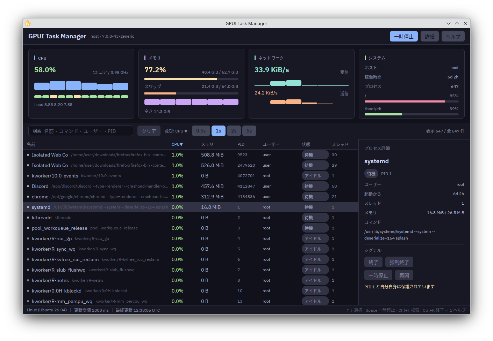

# GPUI Task Manager

Ubuntu 系デスクトップ向けの**システムタスクマネージャー**試作です。
[GPUI](https://github.com/zed-industries/zed/tree/main/crates/gpui)（Zed の GPU
アクセラレート UI フレームワーク）を `gpui-kit 0.9.1` 経由で使い、プロセス・CPU・
メモリ・ネットワーク・ディスクを監視します。クロスプラットフォームと wasm /
ブラウザ対応を見据えた構成です。




- 第一ターゲット: **Kubuntu 2026.04 / KDE Plasma 6 / Wayland**（実機検証）
- スタック: Rust 1.92+ / `gpui-kit =0.9.1`（`gpui-pre 0.3.12`）/ `sysinfo =0.40.3` / `rustix =1.1.6`
- ライセンス: **Apache-2.0**（第三者表示は [NOTICE.md](NOTICE.md)）

## GitHub

- リポジトリ: <https://github.com/Seduce0068/gpui-task-manager>（現在 **private**）
- CI: [`.github/workflows/ci.yml`](.github/workflows/ci.yml)（共通の `Seduce0068/workflows@v1`
  に委譲。fmt → check → test → clippy → cargo audit + wasm check）
- 公開用の `main` はクリーンな1コミット。開発履歴はローカルの `master` に保持している。

## できること（MVP）

- プロセス一覧: 名前・コマンド・CPU・メモリ・PID・ユーザー・状態・スレッド数
- 概要カード: CPU（全体 + コア別 + 履歴）、メモリ / スワップ、ネットワーク
  受信・送信レート、ホスト / 稼働時間 / ディスク使用率
- ソート（列クリック）、絞り込み（名前・コマンド・ユーザー・PID）、詳細パネル
- シグナル操作（SIGTERM / SIGKILL / SIGSTOP / SIGCONT）を**確認ダイアログ経由**で実行
- 安全装置: PID 1 と自分自身の拒否、PID + 起動時刻による PID 再利用検出
- キーボード操作: ↑↓ / PgUp/PgDn / Home/End / Space / Ctrl+F / Ctrl+K / F2 / F5 / F1
- `--demo` で決定的な合成データ起動（スクリーンショット・回帰用）
- ブラウザ版（読み取り専用）: `web/` + `poc-wasm/`。ローカルエージェント経由で
  実データを表示（wasm / GPUI Web）

## クイックスタート（Kubuntu / Wayland）

```bash
# 1. 初回のみ: libxkbcommon-x11 のローカル shim（-dev パッケージが無いホスト向け）
bash scripts/dev-setup.sh

# 2. ビルドとテスト
cargo build -p gpui-task-manager
cargo test --workspace
bash scripts/check.sh        # fmt + clippy + test + wasm コンパイル確認を一括実行

# 3. 起動（実データ / 合成データ）
./target/debug/gpui-task-manager
./target/debug/gpui-task-manager --demo
```

前提パッケージ（Ubuntu 系）:

```bash
sudo apt install -y gcc g++ clang libfontconfig-dev libwayland-dev \
  libxkbcommon-x11-dev libx11-xcb-dev libssl-dev libzstd-dev libvulkan1
```

Vulkan 対応 GPU ドライバが必要です（GTX 1660 SUPER + NVIDIA proprietary で検証）。
`libxkbcommon-x11-dev` を入れられない場合は `scripts/dev-setup.sh` が
`app/native-libs/libxkbcommon-x11.so` を作成します（システム変更なし・root 不要）。

### 読み取り専用エージェント（ブラウザ用）

```bash
cargo run -p tm-agent -- --once --demo      # 1 スナップショットを JSON で出力
# 常用時はトークンを自動生成（stderr に 1 回だけ表示）、--token-file、または TM_AGENT_TOKEN を使う
TM_AGENT_TOKEN=test cargo run -p tm-agent -- --listen 127.0.0.1:18787
curl -s -H 'Authorization: Bearer test' \
  'http://127.0.0.1:18787/api/v1/snapshot?limit=5' | jq .
```

エージェントは `127.0.0.1` のみ bind、`Authorization: Bearer` 必須、読み取り専用、
CORS は localhost オリジンのみ許可します。`--token` はテスト専用です（argv は
同一マシンの他プロセスから読まれ得ます）。常用時は `--token-file` か `TM_AGENT_TOKEN`
を使ってください。

### wasm / ブラウザ

```bash
# ブラウザ版シェル（読み取り専用）
cd web && trunk build --release && trunk serve
# デモ表示:  http://127.0.0.1:8080/
# ライブ表示: http://127.0.0.1:8080/?agent=http://127.0.0.1:18787#token=<token>
#   （トークンは URL フラグメントで渡し、fetch の Authorization ヘッダで送る）

# GPUI Web の最小スパイク（Runtime Proof）
cd poc-wasm && trunk build --release
```

ブラウザ版は `tm-core` / `tm-viewmodel` をネイティブ版と共有し、GPUI Web
（`gpui-pre-web`、WebGPU → WebGL2 自動フォールバック）で描画します。
`tm-agent` に接続しない場合は決定的なデモデータで動作します。プロセス操作は
**提供しません**（読み取り専用）。wasm サイズは約 14 MB（gzip 3.6 MB、
wasm-opt 未適用）。

## アーキテクチャ

```text
tm-core <── tm-viewmodel <── app (GPUI native) / web (GPUI wasm + demo/agent)
   ^                              ^
   +──── tm-platform (native) ────+   sysinfo + rustix（ネイティブのみ）
```

- **UI にロジックを置かない**: 表示状態は `tm-viewmodel` の reducer が所有し、
  シェルは `Command` を投げて `Effect` を実行するだけです。
- **wasm とネイティブで共通部品を共有**: 整形・サニタイズ・ソート/フィルタ・
  履歴・選択ロジックは `tm-core` / `tm-viewmodel` にあります。
- **安全性**: 全 crate で `#![forbid(unsafe_code)]`。シグナルは rustix の安全 API。
  PID 1 / 自分自身を拒否し、PID 再利用を検出します。

詳細は [DESIGN.md](DESIGN.md)（品質特性・データモデル・セキュリティ・ADR）、
調査は [RESEARCH.md](RESEARCH.md) を参照してください。

## リポジトリ構成

| パス | 内容 |
|---|---|
| `crates/tm-core/` | ドメイン型、CPU/ネットワーク差分、履歴、整形、サニタイズ、ソート/フィルタ、`SystemProbe` port |
| `crates/tm-viewmodel/` | `Dashboard` reducer、`Command` / `Effect`、確認ダイアログ状態、選択追従 |
| `crates/tm-platform/` | `NativeProbe`（sysinfo 収集、rustix シグナル、PID 再利用防御） |
| `app/` | ネイティブ GPUI シェル（概要カード、仮想リスト、詳細パネル、ダイアログ） |
| `web/` | wasm シェル（GPUI Web + デモ / エージェント接続、読み取り専用） |
| `poc-wasm/` | GPUI Web の最小スパイク（Runtime Proof・スクリーンショット） |
| `agent/` | ブラウザ用の読み取り専用ループバック HTTP エージェント |
| `notes/` | 調査ノート・wasm スパイク・検証ログ |
| `scripts/` | ビルド補助（`dev-setup.sh`） |

## セキュリティ方針（要約）

詳細は [SECURITY.md](SECURITY.md) を参照してください。

- `unsafe` 禁止（`#![forbid(unsafe_code)]`）、setuid なし、root 権限不要
- シグナル操作は確認ダイアログ必須。PID 1 / 自分自身は拒否。PID + 起動時刻の
  一致を送信直前に再確認
- ブラウザ / デモは**読み取り専用**（操作ボタン無効、エージェントに操作 API なし）
- エージェントは `127.0.0.1` のみ bind、トークン必須、CORS は localhost のみ
- OS 由来の文字列は制御文字・ANSI エスケープを除去して表示
- GPUI / sysinfo / rustix は完全一致ピン、`Cargo.lock` をコミット。`cargo audit` を実行済み（脆弱性 0）

## 検証状況（2026-11-14、Runtime Proof）

| 項目 | 結果 |
|---|---|
| `cargo test --workspace` | **118 passed / 0 failed**（core 49 / viewmodel 15 / platform 9 / agent 39 / app 6） |
| `cargo clippy --workspace --all-targets -- -D warnings` | 成功（警告 0） |
| `cargo fmt --all --check` | 成功 |
| ネイティブ起動（Wayland、実データ） | 成功。約 620 プロセス、CPU/メモリ/ネットワーク表示、stderr 0 行（[画像](notes/assets/task-manager-native-wayland.png)、`--redact` でホスト名（コマンド引数内のホスト名・tailnet ドメインを含む）等をマスク） |
| デモ起動 | 成功（`--demo`、合成データ） |
| エージェント | `/healthz` 200、トークンなし 401、クエリトークン 401、`limit` 動作、CORS、Host 検証 403、405、ループバック強制を確認 |
| wasm スパイク | `trunk build --release` 成功、ヘッドレス Chrome で描画・CJK・入力・fetch を確認（WebGL2 フォールバック） |
| ブラウザ版シェル | `web/` に実装。デモ / ライブ（agent 接続）をヘッドレス Chrome で検証（[画像](notes/assets/web-shell-08-final-live.png)、詳細は [notes/web-shell.md](notes/web-shell.md)） |
| `cargo audit` | 脆弱性 0 / 未保守警告 8 件（GPUI 依存由来） |

詳細は [notes/verification.md](notes/verification.md)、ブラウザ版は
[notes/web-shell.md](notes/web-shell.md)、独立レビューは
[notes/review-2026-11-14.md](notes/review-2026-11-14.md) を参照してください。

## 既知の制限

- Windows / macOS は未検証（コードは `sysinfo` 経由でポータブル）
- ブラウザ版は読み取り専用（OS プロセスはブラウザから取得できないため）
- IME 入力、プロセスツリー、優先度変更、GPU 監視、ライトテーマ、設定永続化は未実装
- ブラウザ wasm は 14 MB（gzip 3.6 MB）で、wasm-opt 未適用
- エージェントはシリアル処理（1 スナップショット約 250 ms）
- GPUI 系は個人アカウントが再公開するスナップショット。完全ピンで運用し、更新は
  まとめて行う必要がある

## ライセンス

Apache-2.0。依存クレートのライセンスと帰属は [NOTICE.md](NOTICE.md) を参照。
既存の AGPL プロジェクト（`work/gpui-file-explorer`）からは**コードをコピーして
いません**（調査ノートのみ参照）。
